<div align="center">



个人使用的原生 Android 签到应用：网易云音乐、百度贴吧、森空岛、哔哩哔哩，一个按钮完成每日任务。


[支持平台](#支持平台) · [安装](#安装) · [使用](#使用) · [凭证与隐私](#凭证与隐私) · [结果说明](#结果说明) · [后台任务](#可选后台任务) · [构建](#构建) · [文档](#文档) · [更新记录](docs/CHANGELOG.md)

</div>

| 完全本地 | 只连官方 | 结果可信 |
| :---: | :---: | :---: |
| 没有自建服务器、公共中转，<br>不需要 Root 或无障碍权限 | 平台凭证只发送到<br>适配器内列出的官方域名 | 所有平台都走真实 HTTP 适配器，<br>生产代码里没有模拟成功的分支 |

Kotlin / Jetpack Compose，Android 8.0（API 26）以上。

> 「一叶签」原名「一键签到」，取自作者名字里的「葉」。包名 `cn.onetap.checkin` 与仓库名沿用旧称，不影响覆盖升级；0.4.5 及更早的安装包里仍显示旧名，应用内名称从下一个版本起更新。

## 当前状态

| 当前版本 | 下载 | 验证状态 |
| --- | --- | --- |
| **0.4.5**（versionCode 9） | [Releases](https://github.com/yejiu0210/one-tap-checkin-android/releases)（私有仓库，需有权限的账号登录） | 原有四平台签到：用户于 2026-10-17 报告真机通过；贴吧自检与点赞待本人覆盖安装验收。详见 [verification.md](docs/verification.md) |

## 支持平台

| 平台 | 执行的任务 | 前提条件 | 接入文档 |
| --- | --- | --- | --- |
| 网易云音乐 | 「黑胶乐签」（两步请求后需服务端今日状态确认） | 资格以官方为准，不引导购买会员 | [netease-vip](docs/integration-netease-vip.md) |
| 百度贴吧 | 已选关注吧签到 + 服务端自检；可选每吧每日随机点赞一帖 | — | [签到](docs/integration-music-tieba.md) · [点赞](docs/integration-tieba-like.md) |
| 森空岛 | 明日方舟、明日方舟：终末地每日签到，支持主账号 + 分身多账号、按角色和区服选择 | 已绑定游戏角色 | [skland](docs/integration-skland.md) |
| 哔哩哔哩 | [会员中心等级加速包](https://big.bilibili.com/mobile/index?location=drawExperienceModule) | 有效大会员、LV1 以上、**手动在官方观看视频一分钟** | [bilibili](docs/integration-bilibili.md) |

> [!NOTE]
> 只执行已选的签到和用户明确要求的每吧每日一次点赞。不做自动评论、刷播放、投币、兑换、购买、付费补签、积分签到或直播签到，也不会购买、续费或使用付费资源。

## 安装

1. 从 Releases 下载 APK，复制到手机后点击安装，按系统提示允许当前来源安装应用。本包是个人测试版，不上架应用商店。
2. 覆盖升级必须使用同一签名。签名不同的包需要先卸载旧版，**卸载会丢失本地密钥和全部数据**。

## 使用

**添加账号**

1. 打开「账号 → 添加账号」，选择平台、填写备注，点「官方网页登录并自动导入」。
2. 在内嵌官网完成登录和官方验证码，检测到授权后会自动校验并保存。如果没有自动返回，点「登录完成，检测账号」。
3. 保存后核对昵称、ID、角色或关注的贴吧。同一平台 ID 不能重复添加。

**各平台说明**

- **森空岛**：打开官方鹰角账号中心。主账号和分身账号分别添加（备注「主账号」「分身账号」），两个账号应显示不同的森空岛 ID。展开各账号选择方舟、终末地的具体角色及区服；未绑定的游戏显示「未绑定」，不算失败。
- **贴吧签到**：可全选或只勾选需要签到的吧。提交后会读取同账号、同吧的当日签到状态，自检通过才显示「签到成功 / 今日已签到」；自检缺项、不可用或仍显示未签时保留「结果待确认」，可稍后重试。
- **贴吧点赞**：旧账号先点「校验 / 刷新」，再勾选各吧的「随机点赞一帖」或点「全选随机一赞」。每个吧每天选一帖，默认关闭；已赞则取消一次再赞，超时保留同帖进度，最多两次尝试。「取消全部随机一赞」只关闭本账号的点赞任务，不撤销已点的赞，也不改变签到勾选或历史。

**日常操作**

| 操作 | 作用 |
| --- | --- |
| 一键签到 | 执行全部已选任务并显示分项结果；某项失败不影响其他独立任务 |
| 仅重试失败 / 待确认项 | 只重跑失败、未知或中断的项。资格不足、登录失效、需手动验证的项要先解决原因，不要反复点击绕过平台限制 |
| 备注 / 更新凭证 | 登录失效时重新走官方网页登录。只能更新为同一平台身份，换账号请另外添加；手动导入在备用入口，凭证留空表示保留原值 |
| 退出本地授权 | 清除本地凭证并停用任务，保留历史 |
| 删除账号和记录 | 删除该账号全部本地数据（不会注销官方 App 的会话） |
| 设置 → 外观 | 跟随系统 / 浅色 / 深色，即时保存；官网网页使用系统 WebView 的深色支持，实际配色由官网决定 |

## 凭证与隐私

- 默认在应用内 WebView 打开官方网页，密码、短信和验证码都由官方页面处理。应用只读取自己的网页登录会话并向平台校验身份，**不读取原版或分身 App 的私有文件**。
- 每次添加或更新前清理上一次会话，导入后再次清理，避免主账号和分身账号复用同一个网页登录。后台任务使用各账号独立加密保存的授权。
- 允许系统截图；手动凭证输入为遮罩显示，森空岛读取授权和校验身份期间会隐藏网页登录内容。官方登录页由平台控制，截图时请自行遮盖手机号等信息。
- 登录边界见 [integration-web-login.md](docs/integration-web-login.md)。

<details>
<summary><b>备用：手动导入凭证</b></summary>

凭证等同于登录授权，务必自己保管，不要发到聊天里。

- **网易云音乐**：在 `https://music.163.com/` 登录，从桌面浏览器 Cookies 获取 `MUSIC_U` 和可选 `__csrf`。旧网易云账号升级后需点「校验 / 刷新」并勾选新任务；旧的普通签到记录会保留，但不会算作乐签完成。
- **贴吧**：在 `https://tieba.baidu.com/` 登录，复制 Cookie 里的 `BDUSS`。可以粘贴完整 Cookie，适配器只取 `BDUSS` 和可选的 `STOKEN`；保存时会刷新关注列表。网页 Cookie 被风控时先在官方完成验证再更新。
- **森空岛**：首选应用内 `https://user.hypergryph.com/login` 官方账号中心，登录后从官方 SDK 读取本次会话的通行证 token，再换取森空岛凭证并校验角色，各账号单独登录。已有本人官方 token 或 `{"cred":"官方cred"}` 时可在备用入口输入，设备标识等高级格式见接入文档。旧的 `web-api.skland.com/account/info/hg` 与账号中心不是同一个站点会话，不要混用。
- **B 站**：在 `https://www.bilibili.com/` 登录，复制 `SESSDATA` 和 `bili_jct`，格式为 `SESSDATA=…; bili_jct=…`，可以带上 `DedeUserID`。

在电脑上拿到凭证后，用你信任的个人方式传到手机，避免公共剪贴板、公共文档和第三方抓包服务，用完可清空剪贴板。凭证有效期由平台决定，没有保证长期有效的刷新机制；森空岛会用通行证 token 重新获取短期 cred / 签名 token。

</details>

## 结果说明

- 「成功」和「今日已签到」都必须有明确的业务字段支持。HTTP 200、缺字段、未知错误码、游客日历都**不算**成功。
- 未绑定、资格不足、登录失效、需手动验证、失败、待确认、尚未接入会分别显示。B 站的领取与经验到账分开显示；平台维护期间只显示领取已受理、经验待发，不虚构到账数值。
- 断网或超时的写请求可能已经到达服务器。只有只读查询明确证明未执行时才会有限重试，查不到状态就保留待确认；进程中断留下的执行中记录会恢复为「中断待确认」。

> [!WARNING]
> 各平台精确的日重置时刻尚未拿到全部官方证据。本地暂按北京时间 00:00 分日，优先以平台只读状态为准；没有可靠状态查询的平台在本地当天完成后不会重复写入。跨日行为仍需真实账号验证。

## 可选后台任务

- 先在前台完成至少一项平台明确确认的签到，设置页才允许开启后台任务；默认关闭。
- 使用 WorkManager（需联网），约每 24 小时执行一次，首次时间按北京时间 HH:mm 设置。不保证准点，可能受省电策略、厂商限制和任务时长限制影响；被系统强制停止后需要重新打开应用。
- 开启通知需要授予通知权限。后台只补跑当天，不补历史，不消耗补签资源。

## 构建

固定工具链：JDK 17、Gradle 8.13、Android Gradle Plugin 8.11.1、Kotlin / Compose 编译插件 2.1.20、Compose BOM 2025.04.01、compile / target SDK 36、Build Tools 35.0.0。依赖来自 Google Maven / Maven Central，仓库自带 Gradle Wrapper 及校验值。

用 Android Studio 导入此目录并安装 SDK 36 与 Build Tools 35.0.0；或在 Windows PowerShell 执行：

```powershell
.\Build.ps1 -JavaHome 'C:\path\to\jdk-17' -SdkPath 'C:\path\to\android-sdk'
```

手动命令：

```powershell
.\gradlew.bat :app:assembleRelease :app:testDebugUnitTest :app:lintRelease
# 连接自己授权的测试设备或启动模拟器后：
.\gradlew.bat :app:connectedDebugAndroidTest
```

产物为 `app/build/outputs/apk/release/app-release.apk`。交付 APK 是关闭调试的 release 构建，使用本机开发测试签名；设备测试使用同源码的 debug 变体。源码中不包含签名私钥、凭证或本机 SDK 路径。

## 文档

| 文档 | 内容 |
| --- | --- |
| [更新记录](docs/CHANGELOG.md) | 各版本改动 |
| [verification.md](docs/verification.md) | 接入状态、验证证据与限制 |
| [maintenance.md](docs/maintenance.md) | 平台适配器维护说明 |
| [integration-web-login.md](docs/integration-web-login.md) | 官方网页登录与自动导入 |
| [integration-*.md](docs/) | 各平台协议核查记录（含参考的上游许可证） |
| [docs/evidence/](docs/evidence/) | 构建、测试、Lint 与 APK 签名证据 |

## 许可证

本项目新写的代码采用 [MIT](LICENSE)；协议参考的上游许可证保留在各接入文档中。

<div align="center">
<sub>一叶签 LeafSign · 个人使用，不上架应用商店 · <a href="#readme">回到顶部</a></sub>
</div>
